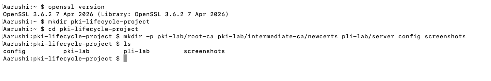
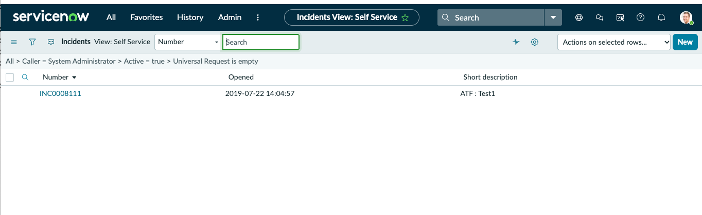

# Phase 1 — Environment Setup

Prepare a local environment to manage digital certificates and simulate enterprise request workflows.

## Tools Required

- OpenSSL
- Terminal (Mac/Linux) or Git Bash (Windows)
- ServiceNow Personal Developer Instance

## Step 1 — Verify OpenSSL

```bash
openssl version
```

**Explanation:** Checks whether OpenSSL is installed and displays its version.

## Step 2 — Create Project Folders

Run from the location where you want the project.

```bash
mkdir pki-lifecycle-project
cd pki-lifecycle-project
mkdir -p pki-lab/root-ca pki-lab/intermediate-ca/newcerts pki-lab/server config screenshots
```

**Explanation:**
- `mkdir` creates a directory.
- `cd` enters the project directory.
- `mkdir -p` creates folders and any missing parent folders.

## Step 3 — Set Up ServiceNow

1. Visit https://developer.servicenow.com.
2. Register or sign in.
3. Request a free Personal Developer Instance (PDI).
4. Open your instance.


**Screenshot 1:** Terminal displaying the OpenSSL version.



**Screenshot 2:** ServiceNow Developer Instance home page.



