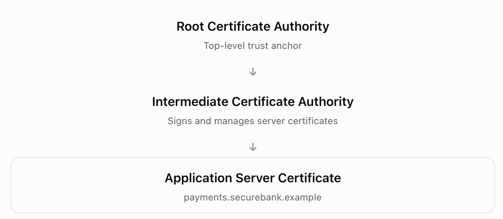
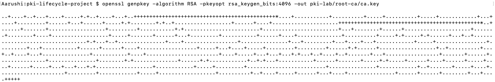
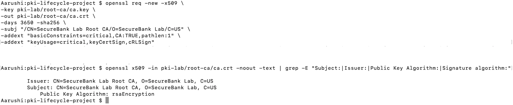
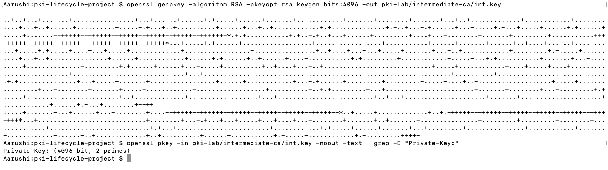
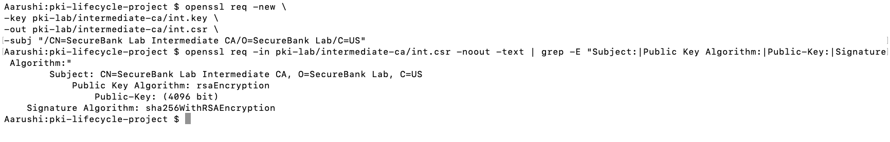
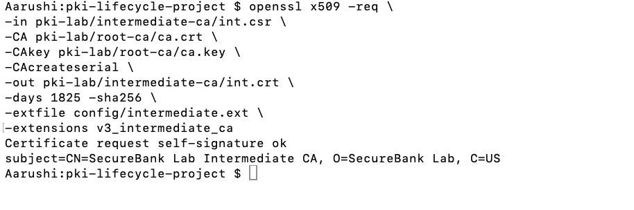
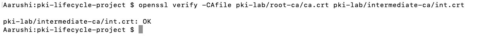

# Phase 2 — PKI Setup

Create a Root CA and an Intermediate CA using OpenSSL.

- **PKI:** System for managing digital certificates and public/private keys.
- **Root CA:** Highest trusted authority in the certificate hierarchy.
- **Intermediate CA:** Issues certificates under the authority of the Root CA.
- **Private Key:** Secret cryptographic key used for signing.
- **Certificate:** Digital document containing identity and public-key information.



## Step 1 — Generate Root CA Private Key

```bash
openssl genpkey -algorithm RSA -pkeyopt rsa_keygen_bits:4096 -out pki-lab/root-ca/ca.key
```

### Command Breakdown

| Term | Meaning |
|---|---|
| `openssl` | Cryptographic command-line tool. |
| `genpkey` | Generates a private key. |
| `-algorithm` | Specifies the cryptographic algorithm. |
| `RSA` | Public-key cryptographic algorithm. |
| `-pkeyopt` | Defines key-generation options. |
| `rsa_keygen_bits:4096` | Creates a 4096-bit RSA key. |
| `-out` | Specifies the output file. |
| `pki-lab/root-ca/ca.key` | Path to the Root CA private key. |

**Expected Result:** `ca.key` is created.




## Step 2 — Generate Root CA Certificate

```bash
openssl req -new -x509 \
-key pki-lab/root-ca/ca.key \
-out pki-lab/root-ca/ca.crt \
-days 3650 -sha256 \
-subj "/CN=SecureBank Lab Root CA/O=SecureBank Lab/C=US" \
-addext "basicConstraints=critical,CA:TRUE,pathlen:1" \
-addext "keyUsage=critical,keyCertSign,cRLSign"
```

### Command Breakdown

| Term | Meaning |
|---|---|
| `req` | Handles certificate requests and self-signed certificate creation. |
| `-new` | Creates a new request or certificate. |
| `-x509` | Generates a self-signed X.509 certificate. |
| `-key` | Specifies the signing private key. |
| `ca.key` | Root CA private-key file. |
| `-out` | Specifies output location. |
| `ca.crt` | Root CA certificate file. |
| `-days 3650` | Certificate validity of approximately 10 years. |
| `-sha256` | Uses SHA-256 for signing. |
| `-subj` | Defines certificate identity information. |
| `CN` | Common Name. |
| `O` | Organization. |
| `C` | Country. |
| `-addext` | Adds a certificate extension. |
| `basicConstraints` | Defines whether the certificate belongs to a CA. |
| `critical` | Requires the extension to be understood and enforced. |
| `CA:TRUE` | Identifies the certificate as a CA certificate. |
| `pathlen:1` | Allows at most one subordinate CA level. |
| `keyUsage` | Defines permitted key operations. |
| `keyCertSign` | Allows certificate signing. |
| `cRLSign` | Allows CRL signing. |
| `\` | Continues the command on the next line. |

**Expected Result:** `ca.crt` is created.



## Step 3 — Generate Intermediate CA Private Key

```bash
openssl genpkey -algorithm RSA -pkeyopt rsa_keygen_bits:4096 -out pki-lab/intermediate-ca/int.key
```

### Command Breakdown

| Term | Meaning |
|---|---|
| `openssl` | Cryptographic command-line tool. |
| `genpkey` | Generates a private key. |
| `-algorithm RSA` | Uses the RSA algorithm. |
| `-pkeyopt` | Supplies key-generation settings. |
| `rsa_keygen_bits:4096` | Sets the key size to 4096 bits. |
| `-out` | Specifies the output file. |
| `int.key` | Intermediate CA private-key file. |

**Expected Result:** `int.key` is created.



## Step 4 — Generate Intermediate CA CSR

```bash
openssl req -new \
-key pki-lab/intermediate-ca/int.key \
-out pki-lab/intermediate-ca/int.csr \
-subj "/CN=SecureBank Lab Intermediate CA/O=SecureBank Lab/C=US"
```

### Command Breakdown

| Term | Meaning |
|---|---|
| `req` | Handles certificate signing requests. |
| `-new` | Creates a new CSR. |
| `-key` | Specifies the private key. |
| `int.key` | Intermediate CA private key. |
| `-out` | Specifies output location. |
| `int.csr` | Intermediate CA signing request. |
| `-subj` | Defines identity information. |
| `CN` | Common Name. |
| `O` | Organization. |
| `C` | Country. |

**Expected Result:** `int.csr` is created.



## Step 5 — Sign Intermediate CA Certificate

Before running this command, create `config/intermediate.ext` using the configuration supplied in the project instructions.

```bash
openssl x509 -req \
-in pki-lab/intermediate-ca/int.csr \
-CA pki-lab/root-ca/ca.crt \
-CAkey pki-lab/root-ca/ca.key \
-CAcreateserial \
-out pki-lab/intermediate-ca/int.crt \
-days 1825 -sha256 \
-extfile config/intermediate.ext \
-extensions v3_intermediate_ca
```

### Command Breakdown

| Term | Meaning |
|---|---|
| `x509` | Processes X.509 certificates. |
| `-req` | Reads a CSR for certificate signing. |
| `-in` | Specifies the input file. |
| `int.csr` | CSR to be signed. |
| `-CA` | Specifies the issuing CA certificate. |
| `ca.crt` | Root CA certificate. |
| `-CAkey` | Specifies the CA signing private key. |
| `ca.key` | Root CA private key. |
| `-CAcreateserial` | Creates a CA serial-number file if needed. |
| `-out` | Specifies the signed certificate file. |
| `int.crt` | Intermediate CA certificate. |
| `-days 1825` | Validity of approximately five years. |
| `-sha256` | SHA-256 signing hash. |
| `-extfile` | Loads certificate extension settings. |
| `intermediate.ext` | Configuration file for Intermediate CA extensions. |
| `-extensions` | Selects a configuration section. |
| `v3_intermediate_ca` | Section defining Intermediate CA permissions. |

**Expected Result:** `int.crt` is created.




## Step 6 — Verify Intermediate Certificate

```bash
openssl verify -CAfile pki-lab/root-ca/ca.crt pki-lab/intermediate-ca/int.crt
```

### Command Breakdown

| Term | Meaning |
|---|---|
| `verify` | Checks certificate validity and trust. |
| `-CAfile` | Specifies trusted CA certificates. |
| `ca.crt` | Trusted Root CA certificate. |
| `int.crt` | Intermediate certificate being verified. |

**Expected Result:** `OK`

Hence, established a two-level PKI trust hierarchy with a Root CA and an Intermediate CA.

## Screenshot



