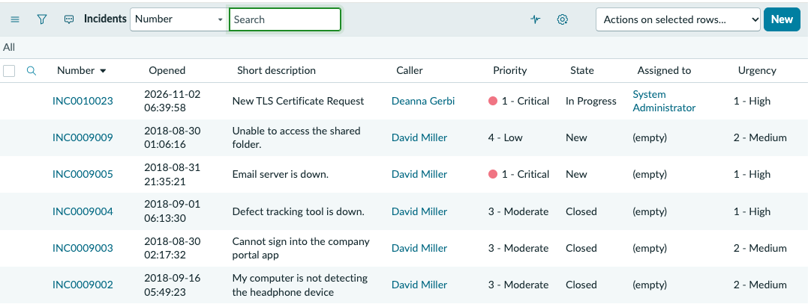
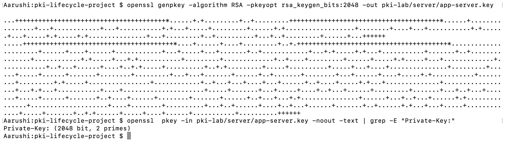
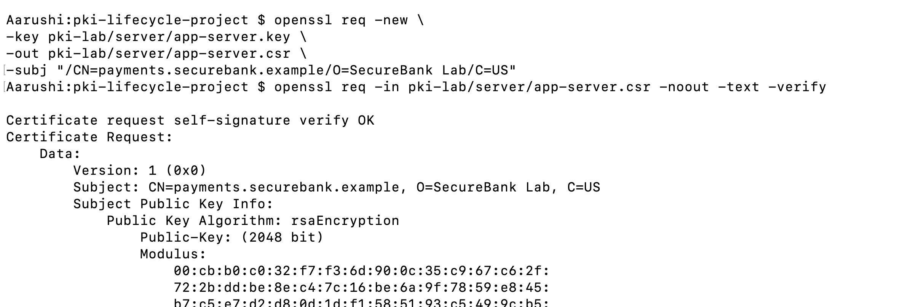
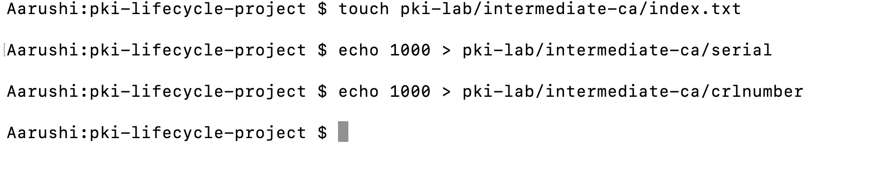
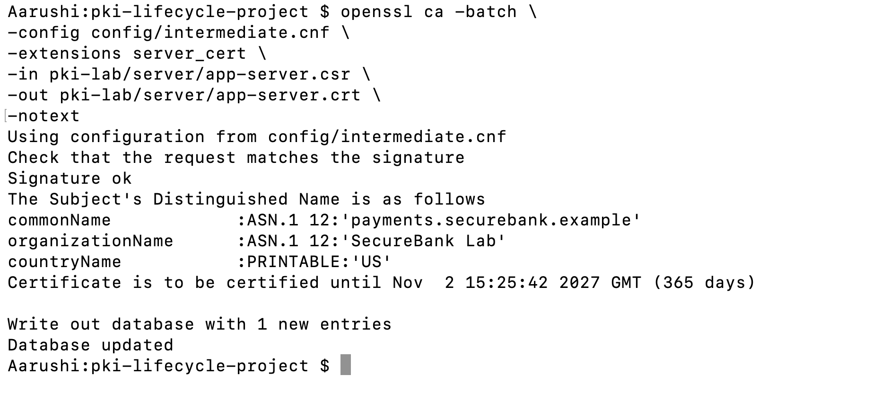
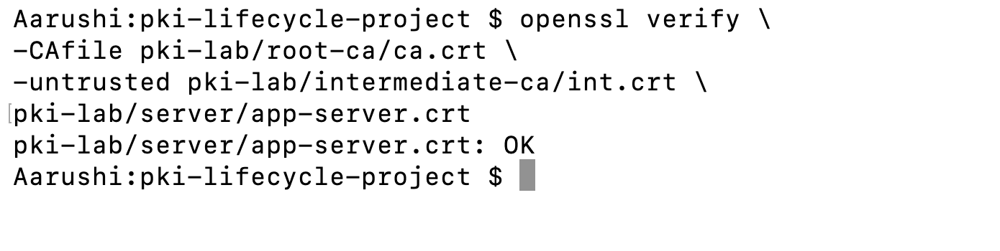
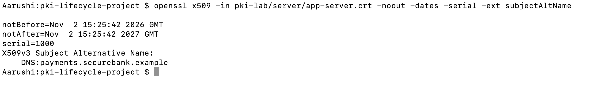
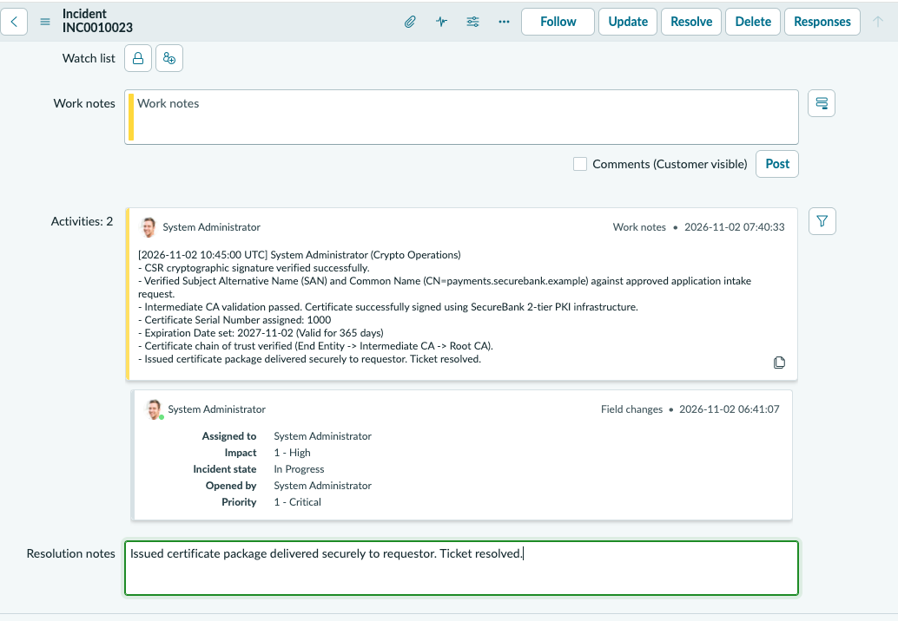
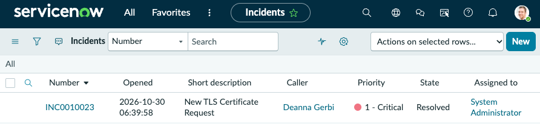

# Phase 3 — Certificate Request and Issuance

Simulate application certificate request intake, CSR validation, issuance, and verification using ServiceNow and OpenSSL.

## Business Scenario

The Payment Application Team requests a TLS certificate for:`payments.securebank.example`

## Process:

Application Team Requests certificate

↓

ServiceNow Records request and approval

↓

Application Team Generates private key + CSR

↓

IT Security Analyst Validates authorization and CSR

↓

Intermediate CA Signs approved CSR

↓

IT Security Analyst Verifies and delivers certificate

↓

Application Team Deploys and tests TLS

↓

Certificate Ready for Use

## Step 1 — Create ServiceNow Request

Create a ServiceNow request using an available workflow.

**Ticket details:**



## Step 2 — Generate Server Private Key

```bash
openssl genpkey -algorithm RSA -pkeyopt rsa_keygen_bits:2048 -out pki-lab/server/app-server.key
```

### Command Breakdown

| Term | Meaning |
|---|---|
| `openssl` | Cryptographic tool. |
| `genpkey` | Generates a private key. |
| `-algorithm RSA` | Selects RSA encryption/signing algorithm. |
| `-pkeyopt` | Supplies key-generation options. |
| `rsa_keygen_bits:2048` | Generates a 2048-bit RSA key. |
| `-out` | Defines output location. |
| `app-server.key` | Server private-key filename. |

**Expected Result:** Server private key generated.



## Step 3 — Generate CSR

```bash
openssl req -new \
-key pki-lab/server/app-server.key \
-out pki-lab/server/app-server.csr \
-subj "/CN=payments.securebank.example/O=SecureBank Lab/C=US"
```

### Command Breakdown

| Term | Meaning |
|---|---|
| `req` | Handles certificate requests. |
| `-new` | Creates a new CSR. |
| `-key` | Specifies the private key. |
| `app-server.key` | Server private key. |
| `-out` | Specifies output file. |
| `app-server.csr` | Certificate Signing Request. |
| `-subj` | Defines identity details. |
| `CN` | Common Name (domain). |
| `O` | Organization. |
| `C` | Country. |

**Expected Result:** CSR file generated.

## Step 4 — Validate CSR

```bash
openssl req -in pki-lab/server/app-server.csr -noout -text -verify
```

### Command Breakdown

| Term | Meaning |
|---|---|
| `req` | Processes certificate requests. |
| `-in` | Identifies the input file. |
| `app-server.csr` | CSR being inspected. |
| `-noout` | Suppresses encoded request output. |
| `-text` | Displays readable request details. |
| `-verify` | Verifies the CSR signature. |

**Expected Result:** CSR signature verification succeeds.

**Important:** CSR validity does not establish requester authorization. Authorization must be checked through the request workflow.



## Step 5 — Initialize CA Database

Run these commands once for a new Intermediate CA, before the first certificate issuance.

```bash
touch pki-lab/intermediate-ca/index.txt
```

| Term | Meaning |
|---|---|
| `touch` | Creates an empty file if one doesn't exist. |
| `index.txt` | CA database tracking issued and revoked certificates. |

```bash
echo 1000 > pki-lab/intermediate-ca/serial
```

| Term | Meaning |
|---|---|
| `echo` | Prints text or a value. |
| `1000` | Starting certificate serial number (hexadecimal in the CA database). |
| `>` | Writes output to a file, replacing existing contents. |
| `serial` | File storing the next serial number. |

```bash
echo 1000 > pki-lab/intermediate-ca/crlnumber
```

| Term | Meaning |
|---|---|
| `echo` | Prints a value. |
| `1000` | Initial CRL number. |
| `>` | Writes the value to a file. |
| `crlnumber` | Stores the next Certificate Revocation List number. |

**Expected Result:** The CA tracking files are initialized.



**Warning:** Do not repeat the two `echo` commands after issuing certificates. They overwrite existing counters.

Before proceeding, create `config/intermediate.cnf` using the configuration supplied in the project instructions.

## Step 6 — Issue Server Certificate

```bash
openssl ca -batch \
-config config/intermediate.cnf \
-extensions server_cert \
-in pki-lab/server/app-server.csr \
-out pki-lab/server/app-server.crt \
-notext
```

### Command Breakdown

| Term | Meaning |
|---|---|
| `ca` | Performs Certificate Authority operations. |
| `-batch` | Runs without interactive approval prompts. |
| `-config` | Specifies OpenSSL configuration. |
| `intermediate.cnf` | Intermediate CA configuration file. |
| `-extensions` | Selects certificate extension settings. |
| `server_cert` | Configuration section for TLS server certificates. |
| `-in` | Identifies the input CSR. |
| `app-server.csr` | Application server CSR. |
| `-out` | Specifies output location. |
| `app-server.crt` | Signed server certificate. |
| `-notext` | Excludes extra readable text from the certificate output. |

**Expected Result:** Certificate issued and recorded in the CA database.



## Step 7 — Verify Certificate Chain

```bash
openssl verify \
-CAfile pki-lab/root-ca/ca.crt \
-untrusted pki-lab/intermediate-ca/int.crt \
pki-lab/server/app-server.crt
```

### Command Breakdown

| Term | Meaning |
|---|---|
| `verify` | Validates the certificate chain. |
| `-CAfile` | Defines the trusted Root CA file. |
| `ca.crt` | Root CA trust anchor. |
| `-untrusted` | Provides additional chain certificates. |
| `int.crt` | Intermediate CA certificate. |
| `app-server.crt` | Certificate being verified. |

**Expected Result:** `OK`



## Step 8 — Inspect Certificate Details

```bash
openssl x509 -in pki-lab/server/app-server.crt -noout -dates -serial -ext subjectAltName
```

### Command Breakdown

| Term | Meaning |
|---|---|
| `x509` | Processes X.509 certificates. |
| `-in` | Specifies the certificate file. |
| `app-server.crt` | Issued TLS certificate. |
| `-noout` | Suppresses encoded certificate output. |
| `-dates` | Displays validity start and expiry dates. |
| `-serial` | Displays the certificate serial number. |
| `-ext` | Displays a specific certificate extension. |
| `subjectAltName` | Lists approved DNS names or IP addresses for the certificate. |

**Expected Result:** Certificate information is displayed, including the intended DNS name.



## Step 9 — Update ServiceNow

Document:

- CSR signature verification
- Request approval, if actually completed
- Certificate issuance
- Certificate serial number
- Expiration date
- Successful chain verification

Mark the request Completed or Resolved as appropriate.




Hence, we demonstrated certificate request handling, CSR validation, issuance, verification, and operational documentation.


## Things to Note

**Initializing the CA DB**

Initializing a Certificate Authority (CA) database creates the lightweight tracking ledger that a CA uses to maintain state. Without it, a CA is "blind"—it cannot track which certificates it has issued, when they expire, or which ones have been revoked.

**Why do we need it?**

A CA isn't just a cryptographic key pair; it is an issuing authority. To operate responsibly, it must keep track of every digital asset it creates.

Preventing Serial Number Collisions: Every certificate issued by a CA must have a globally unique serial number. The database maintains a counter so no two certificates share a serial number.

Tracking Expiration & Revocation: When an application team reports a key leak, the CA looks up the certificate in its database, marks it revoked, and uses that entry to publish a Certificate Revocation List (CRL) or update an OCSP responder.

Auditability & Compliance: Security frameworks (PCI-DSS, SOC 2, ISO 27001) require a clear log of every issued certificate, who requested it, and when it expires.

**What Happens When You Initialize the Database?**

When you initialize an OpenSSL-style CA database, you create three core files:

- index.txt (The Ledger): An empty flat-text database file where OpenSSL records certificate metadata (Status: Valid/Revoked, Expiration Date, Revocation Date, Serial Number, and Subject DN).

- serial (The Serial Counter): A text file containing a starting hexadecimal number (e.g., 1000). Each time you sign a CSR, OpenSSL reads this number, assigns it to the new certificate, and increments it by 1.

- crlnumber (The CRL Counter): A text file containing a starting sequence number for tracking Certificate Revocation Lists. Every time you publish a new CRL, this number increments so clients know they have the latest revocation list.


**How Is This Done in Real SOC / Crypto Operations Teams?**

In production enterprise environments, teams rarely manage flat text files like index.txt manually. Instead, they use commercial Enterprise PKI Platforms or Certificate Lifecycle Management (CLM) tools.

OpenSSL Lab Component           Enterprise Production Equivalent
index.txt & serialRelational Database (SQL/PostgreSQL) embedded inside Microsoft ADCS, Primekey EJBCA, HashiCorp Vault, or AWS Private CA.Manual Terminal CommandsAutomated APIs and workflows (ACME protocol, EST, or ServiceNow integration).crl.pem GenerationAutomated distribution points hosted on high-availability web servers or S3 buckets.


| **OpenSSL Lab Component** | **Enterprise Production Equivalent** |
|---|---|
| index.txt & serial | Relational Database (SQL/PostgreSQL) embedded inside Microsoft ADCS, Primekey EJBCA, HashiCorp Vault, or AWS Private CA |
| Manual Terminal Commands | Automated APIs and workflows (ACME protocol, EST, or ServiceNow integration) |
| crl.pem Generation| Automated distribution points hosted on high-availability web servers or S3 buckets.|