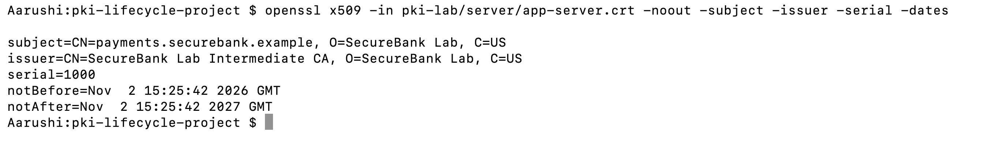
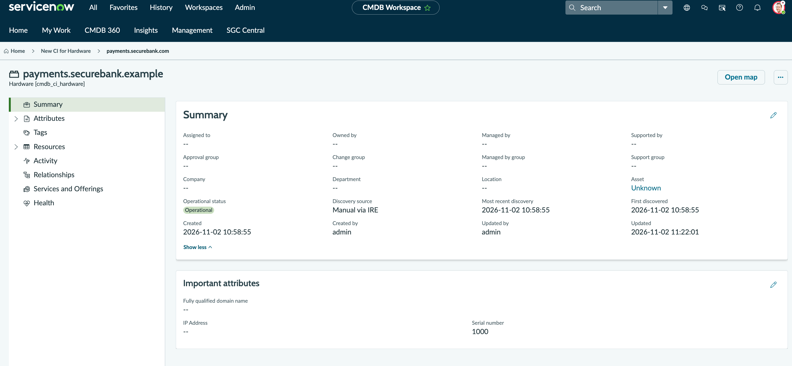
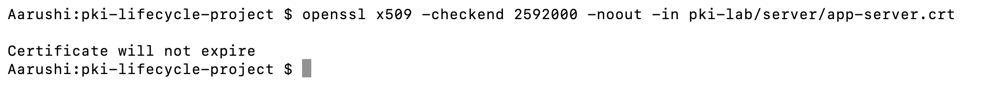

# Phase 4 — Certificate Inventory Management

Maintain a certificate inventory to track ownership, expiration, status, and renewal requirements.

## Process:

Certificate Issued

↓

IT Security Analyst Extracts Certificate Metadata

↓

Application Owner Confirmed

↓

Certificate Recorded in ServiceNow

↓

Expiration Monitored

↓

Renewal Needs Identified

## Step 1 — Extract Certificate Metadata

```bash
openssl x509 -in pki-lab/server/app-server.crt -noout -subject -issuer -serial -dates
```

### Command Breakdown

| Term | Meaning |
|---|---|
| `openssl` | Cryptographic tool. |
| `x509` | Processes X.509 certificates. |
| `-in` | Specifies the input certificate. |
| `app-server.crt` | Server certificate file. |
| `-noout` | Suppresses encoded output. |
| `-subject` | Displays certificate owner identity. |
| `-issuer` | Displays the issuing CA. |
| `-serial` | Displays unique certificate serial number. |
| `-dates` | Displays validity start and expiry dates. |

**Expected Result:** Certificate metadata is displayed.



## Step 2 — Register Certificate in ServiceNow

Use an available CMDB, certificate management, or lab asset-tracking table.

Record:

| Field | Value |
|---|---|
| Certificate Name | payments.securebank.example |
| Application | Payment Platform |
| Issuer | SecureBank Lab Intermediate CA |
| Serial Number | Actual certificate serial |
| Valid From | Actual certificate date |
| Expiration Date | Actual certificate expiry |
| Owner | Payment Application Team |
| Status | Issued |
| Ticket Reference | Actual request number |

The status should reflect the certificate's actual lifecycle state. Do not mark it Installed unless deployment has been verified.



## Step 3 — Check Certificate Expiration

```bash
openssl x509 -checkend 2592000 -noout -in pki-lab/server/app-server.crt
```

### Command Breakdown

| Term | Meaning |
|---|---|
| `x509` | Processes X.509 certificates. |
| `-checkend` | Checks whether a certificate expires within a given number of seconds. |
| `2592000` | 30 days expressed in seconds. |
| `-noout` | Suppresses encoded certificate output. |
| `-in` | Specifies the input file. |
| `app-server.crt` | Certificate being checked. |

**Expected Result:**

- Exit code `0`: Certificate remains valid beyond 30 days.
- Exit code `1`: Certificate expires within 30 days or is already expired.



Note: This checks local certificate expiry. It does not create automatic alerts.

Hence, demonstrated certificate inventory management, expiration checking, ownership tracking, and lifecycle documentation.