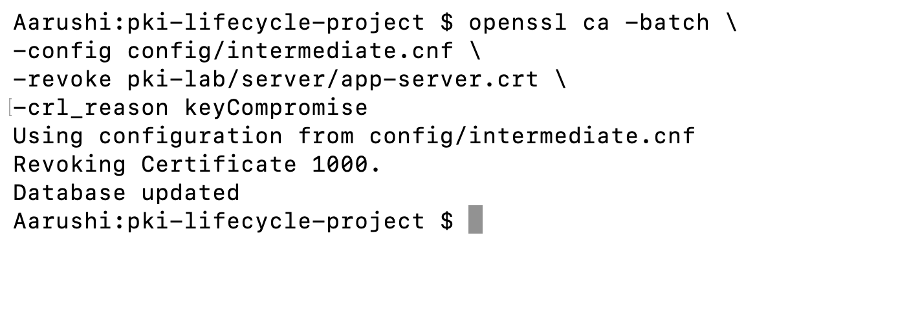
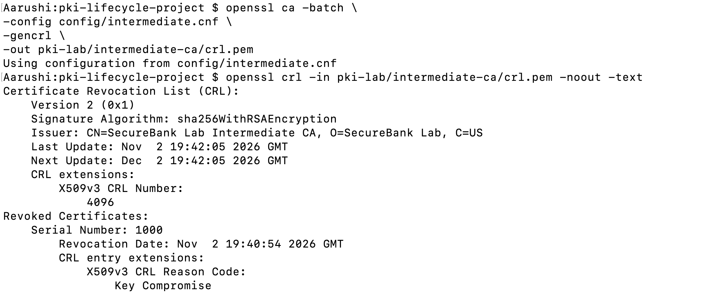
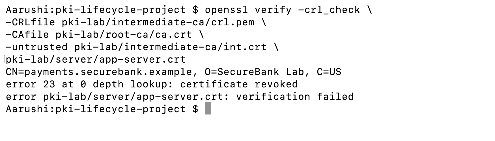

# Phase 6 — Certificate Revocation and Incident Handling


Simulate emergency certificate revocation following a suspected application private-key compromise.

## Business Scenario

A hypothetical security alert reports that the original Payment Application private key may have been exposed.

The Crypto Operations team must revoke the original certificate and document the response.

No real incident occurred.

## Process:

SOC Detects / Receives Suspected Compromise

↓

SOC Investigates

↓

Crypto Ops Identifies Certificate

↓

Application Team + Crypto Ops Coordinate Replacement

↓

Intermediate CA Records Revocation

↓

Revocation Information Made Available
    ├── a. CRL
    └── b. OCSP (if configured)

↓

Client Checks Certificate Status

↓

Revoked Certificate Rejected

↓

ServiceNow Inventory and Incident Updated

## Step 1 — Create ServiceNow Incident

Record:

- Short Description: Suspected TLS Private Key Compromise
- Application: Payment Platform
- Domain: payments.securebank.example
- Priority: High (simulation)
- Status: In Progress
- Description: Simulated suspected key compromise requiring certificate revocation.

## Step 2 — Revoke Original Certificate

```bash
openssl ca -batch \
-config config/intermediate.cnf \
-revoke pki-lab/server/app-server.crt \
-crl_reason keyCompromise
```

### Command Breakdown

| Term | Meaning |
|---|---|
| `openssl` | Cryptographic tool. |
| `ca` | Performs CA operations. |
| `-batch` | Runs without interactive confirmation. |
| `-config` | Specifies the CA configuration. |
| `intermediate.cnf` | Intermediate CA settings and database paths. |
| `-revoke` | Marks a certificate as revoked in the CA database. |
| `app-server.crt` | Original certificate being revoked. |
| `-crl_reason` | Specifies why the certificate was revoked. |
| `keyCompromise` | Standard revocation reason indicating suspected key exposure. |

**Expected Result:** `Database updated`



## Step 3 — Generate Certificate Revocation List

```bash
openssl ca -batch \
-config config/intermediate.cnf \
-gencrl \
-out pki-lab/intermediate-ca/crl.pem
```

### Command Breakdown

| Term | Meaning |
|---|---|
| `ca` | Performs CA operations. |
| `-batch` | Suppresses interactive confirmation. |
| `-config` | Specifies configuration file. |
| `intermediate.cnf` | Issuing CA configuration. |
| `-gencrl` | Generates a Certificate Revocation List. |
| `-out` | Specifies output location. |
| `crl.pem` | Revocation list file. |
| `PEM` | Text-based encoding format for cryptographic data. |

**Expected Result:** CRL file created.

## Step 4 — Inspect CRL

```bash
openssl crl -in pki-lab/intermediate-ca/crl.pem -noout -text
```

### Command Breakdown

| Term | Meaning |
|---|---|
| `crl` | Processes Certificate Revocation Lists. |
| `-in` | Specifies input CRL. |
| `crl.pem` | Generated revocation list. |
| `-noout` | Suppresses encoded CRL output. |
| `-text` | Displays readable revocation details. |

**Expected Result:** The original certificate serial number appears in the revoked certificates section.



## Step 5 — Verify Certificate Revocation

```bash
openssl verify -crl_check \
-CRLfile pki-lab/intermediate-ca/crl.pem \
-CAfile pki-lab/root-ca/ca.crt \
-untrusted pki-lab/intermediate-ca/int.crt \
pki-lab/server/app-server.crt
```

### Command Breakdown

| Term | Meaning |
|---|---|
| `verify` | Validates a certificate. |
| `-crl_check` | Checks revocation status using a CRL. |
| `-CRLfile` | Specifies the CRL file. |
| `crl.pem` | List of revoked certificates. |
| `-CAfile` | Specifies trusted Root CA certificates. |
| `ca.crt` | Root CA certificate. |
| `-untrusted` | Supplies an intermediate chain certificate. |
| `int.crt` | Intermediate CA certificate. |
| `app-server.crt` | Certificate being checked for revocation. |

**Expected Result:** `certificate revoked`



This verification failure is the desired result because the original certificate was revoked.

## Step 6 — Update ServiceNow

Update the original certificate record:

- Status: Revoked
- Reason: Simulated key compromise
- Date: Actual revocation date
- Incident: Actual ServiceNow ticket number

Record incident work notes:

"Simulated key compromise assessed. Original certificate revoked in the CA database. CRL generated and local revocation check completed. Certificate inventory updated."


Hence, demonstrated local certificate revocation, CRL generation, revocation verification, inventory updates, and incident documentation.

## Limitation
