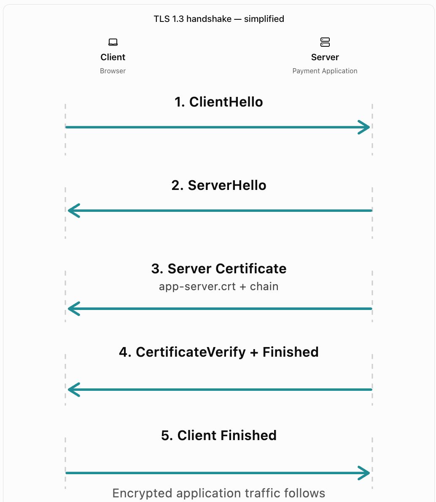
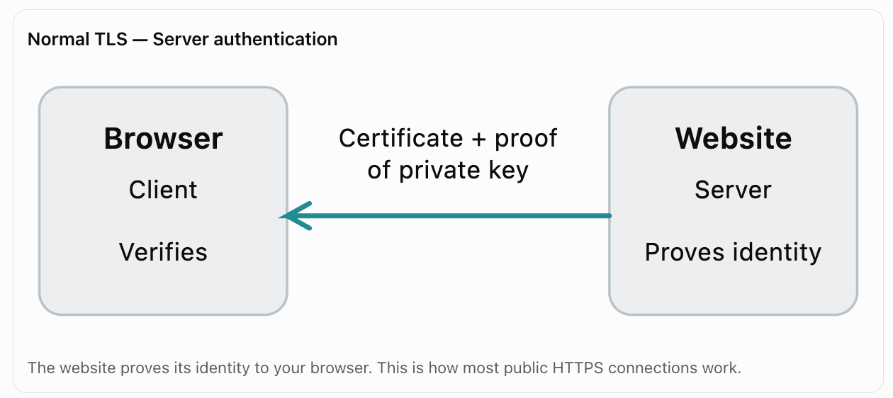
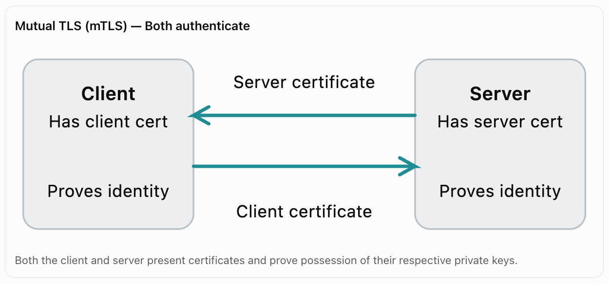

# Where is your certificate used in a TLS session?

Your generated certificate (`app-server.crt`) comes into play during the TLS handshake, when a client (such as a browser) connects to your application's server.

The certificate is used to prove the server's identity before secure communication begins.

Let's use this project's payment application as an example.



## What happens at each step?

| Step                 | Actor   | What happens                                                                                     |
| -------------------- | ------- | ------------------------------------------------------------------------------------------------ |
| 1. ClientHello       | Browser | Connects to `payments.securebank.example` and proposes TLS parameters and key shares.            |
| 2. ServerHello       | Server  | Selects the TLS parameters and contributes its key share.                                        |
| 3. Certificate       | Server  | Sends `app-server.crt` and usually the Intermediate CA certificate.                              |
| 4. Validation        | Browser | Checks hostname (SAN), validity, chain of trust and, where applicable, revocation status.        |
| 5. CertificateVerify | Server  | Uses `app-server.key` to sign handshake data, proving it controls the corresponding private key. |
| 6. Finished          | Both    | Verify handshake integrity and complete authentication.                                          |
| 7. Application data  | Both    | Exchange encrypted requests and responses using symmetric session keys.                          |

Important: The certificate isn't used to directly encrypt every message in modern TLS. It authenticates the server; separate symmetric session keys protect application traffic.

## How does the server know where to get the certificate?

This is the missing link between your OpenSSL project and a real TLS connection.

In your lab, you created:

```
pki-lab/server/
├── app-server.key
├── app-server.csr
└── app-server.crt
```

But generating these files does not automatically make a web server use them. An application administrator must configure the TLS endpoint (for example, Nginx, Apache, or a load balancer) to use the certificate and its private key.


## Who proves their identity in the TLS Handshake - Server or Client?

In a normal HTTPS/TLS connection, the server proves its identity to the browser first. The browser does not usually prove its identity using a certificate.

In a mutual TLS, bith need to prove their identity.







## When does the client use a certificate?

In mutual TLS (mTLS), commonly used for enterprise systems and service-to-service communication.

For example, consider a bank's payment application connecting to another internal banking service.
1. The payment application connects to the banking API.
2. The banking API presents its server certificate.
3. The payment application verifies the API's identity.
4. The API requests a client certificate.
5. The payment application presents its own client certificate and proves possession of its private key.
6. Both sides validate the relevant certificates before completing mutual authentication.

Even with mTLS, the application may still need separate authorization to access specific resources.


### Note: The server or the client doesn't simply prove it owns a certificate. The certificate is public and can be copied by anyone. It proves possession of the private key corresponding to the public key inside the certificate. That is what makes the authentication meaningful. 